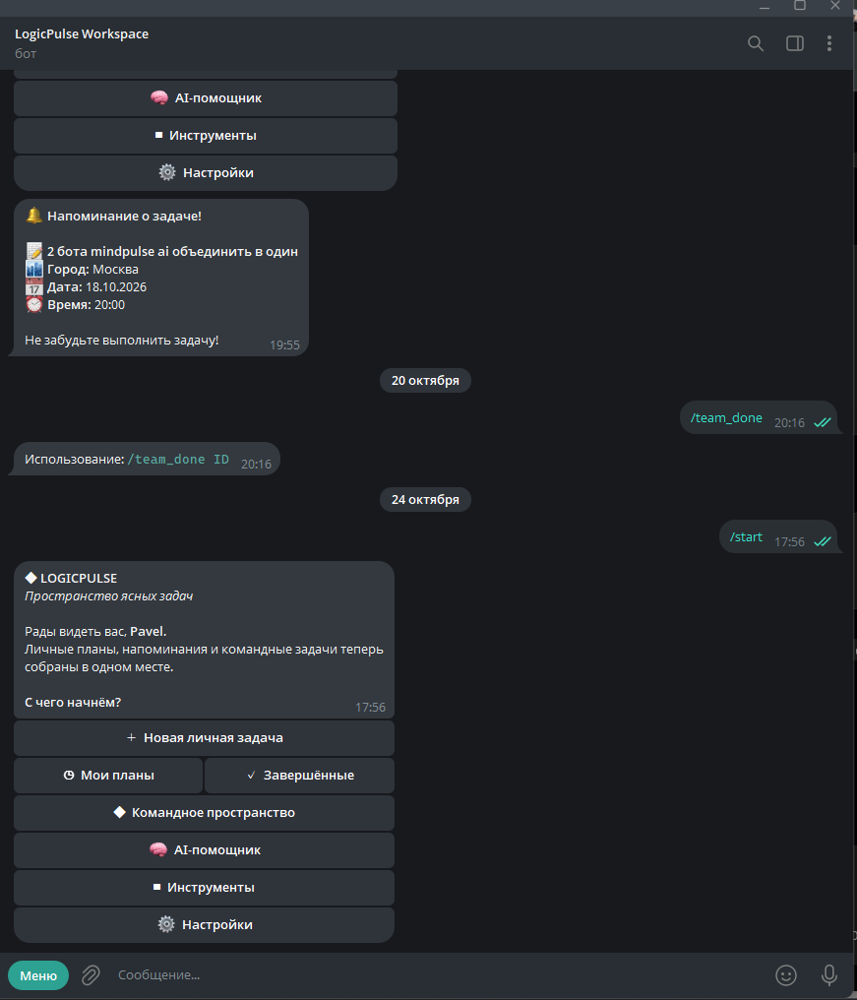

# LogicPulse Workspace Bot

[](https://www.python.org/)
[](https://docs.aiogram.dev/)
[](https://github.com/pavellukonin7-ai/LogicPulse-Workspace-Bot/actions/workflows/tests.yml)
[](VERSION)

Единый Telegram-бот для личных планов, командных задач, напоминаний и работы
с AI. Проект объединяет управление задачами, AI-помощника, генератор QR-кодов
и безопасный математический калькулятор в одном интерфейсе.



## Возможности

- личные задачи с городом, датой и временем;
- автоматические напоминания;
- общее командное пространство;
- завершение, удаление и фильтрация задач;
- экспорт командных задач в CSV;
- AI-помощник с подтверждением действий;
- контекст до 20 последних сообщений;
- Cloud.ru Foundation Models и `deepseek-ai/DeepSeek-V4-Pro`;
- генерация крупных QR-кодов в PNG с коррекцией ошибок H;
- безопасный локальный калькулятор;
- SQLite без внешней базы данных;
- работа 24/7 через `systemd`;
- автоматическое переподключение после сетевых ошибок.

## Команды

| Команда | Назначение |
|---|---|
| `/start` | Открыть главное меню |
| `/menu` | Вернуться в главное меню |
| `/add` | Создать личную задачу |
| `/team` | Открыть командное пространство |
| `/team_add` | Создать командную задачу |
| `/team_done ID` | Завершить командную задачу |
| `/team_delete ID` | Удалить командную задачу |
| `/team_user Имя` | Показать задачи участника |
| `/team_csv` | Экспортировать задачи в CSV |
| `/ai` | Открыть AI-помощника |
| `/calc выражение` | Выполнить вычисление |
| `/cancel` | Отменить текущий сценарий |

Генератор QR-кодов открывается кнопкой **«Создать QR-код»** в разделе
**«Инструменты»**.

## Быстрый локальный запуск

```bash
git clone https://github.com/pavellukonin7-ai/LogicPulse-Workspace-Bot.git
cd LogicPulse-Workspace-Bot
python3 -m venv .venv
source .venv/bin/activate
python -m pip install -r requirements.txt
cp .env.example .env
```

Заполните `.env`:

```env
BOT_TOKEN=your_telegram_bot_token
OPENAI_API_KEY=your_cloud_ru_api_key
OPENAI_BASE_URL=https://foundation-models.api.cloud.ru/v1
OPENAI_MODEL=deepseek-ai/DeepSeek-V4-Pro
TEMPERATURE=0.8
MAX_TOKENS=1000
MAX_CONTEXT_MESSAGES=20
REQUEST_TIMEOUT_SECONDS=120
LOG_LEVEL=INFO
APP_TIMEZONE=Europe/Moscow
```

Запуск:

```bash
python main.py
```

Без `OPENAI_API_KEY` задачи, напоминания, QR-коды и калькулятор продолжат
работать; недоступен будет только AI-помощник.

## Установка на Ubuntu 24/7

```bash
sudo bash deploy/install-server.sh
sudo bash deploy/configure-cloudru.sh
```

Проверка:

```bash
systemctl is-active logicpulse-bot.service
bash /opt/logicpulse-bot/LogicPulse_Bot/deploy/check-mvp-ai.sh
journalctl -u logicpulse-bot.service -n 50 --no-pager
```

Подробности: [серверная установка](docs/SERVER_DEPLOY.md) и
[настройка AI-помощника](docs/AI_ASSISTANT.md).

## Структура

```text
.
├── main.py
├── tg_LogicPulse_bot/
│   ├── bot/             # запуск и планировщик
│   ├── config/          # переменные окружения
│   ├── database/        # SQLAlchemy и SQLite
│   ├── handlers/        # команды и сценарии Telegram
│   ├── keyboards/       # inline-интерфейс
│   ├── services/        # AI, QR и калькулятор
│   └── utils/
├── deploy/              # systemd и серверные скрипты
├── docs/
└── tests/
```

## Безопасность

- секреты хранятся только в `.env`;
- `.env`, SQLite-базы, логи и виртуальные окружения исключены из Git;
- AI не изменяет задачи без подтверждения пользователя;
- калькулятор не использует `eval` и блокирует доступ к объектам Python;
- серверный скрипт запрашивает API-ключ скрытым вводом.

Не публикуйте токены Telegram и API-ключи в issues, коммитах или логах.

## Тестирование

```bash
python -m unittest discover -s tests -v
```

Текущая сборка проходит 22 автоматических теста.

## Автор

**Павел Луконин** — LogicPulse.

